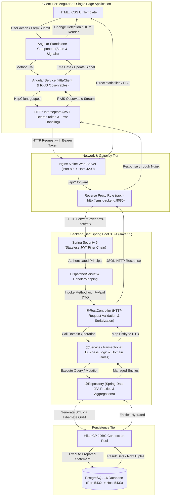
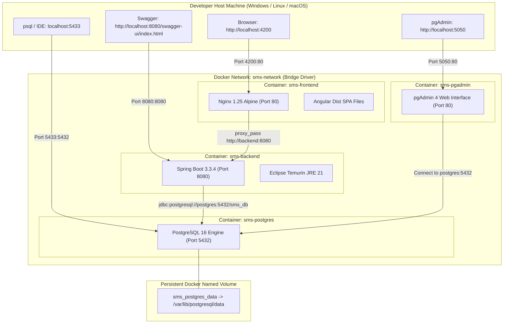

# 📘 PART 1: Full-Stack Architecture, End-to-End Execution Flow, & Developer Mental Model

---

## 🎯 Project Purpose & Core Ideology

### 📌 Purpose: Why This System Exists
Academic institutions often struggle with fragmented records, slow query latency, and fragile administrative workflows across disparate spreadsheets or outdated monolithic systems. The **Student Management System (SMS)** was engineered to solve these core operational challenges:

1. **Centralized Student Lifecycle Governance**: Provide administrative staff with a single, authoritative ledger to enroll, update, monitor, and audit students across diverse academic departments with complete historical accuracy.
2. **Real-Time Institutional Visibility**: Deliver instant, single-query executive metrics (Active, Inactive, Suspended, Total registrations) without imposing database lock contention or multi-second report delays.
3. **Enterprise Security & Session Sovereignty**: Protect student privacy and administrative credentials via cryptographic authentication (HMAC-SHA512 JWTs, BCrypt key derivation), strict session invalidation upon password alteration, and emergency self-service recovery.
4. **Developer Pedagogical Benchmark**: Serve as a production-grade blueprint demonstrating modern clean code principles, Domain-Driven Design (DDD), automated Flyway migrations, and reproducible multi-stage Docker deployment.

---

### 🏛️ The 6 Pillars of Engineering Ideology

Every architectural decision and line of code in this repository adheres to six core design philosophies:

1. **Relational Truth & Data Integrity First**: The relational database is the supreme authority. Relational constraints (`UNIQUE` email/enrollment, `NOT NULL`, default values) are enforced at the PostgreSQL engine level, guaranteeing that invalid data can never enter the system regardless of application-layer bugs.
2. **Stateless Scalability by Design**: No server-side HTTP session state (`HttpSession`) is ever stored in JVM memory. By relying on stateless JWTs coupled with database-backed `token_version` tracking, backend containers can be horizontally scaled, stopped, or restarted behind load balancers with zero disruption or lost sessions.
3. **Strict Separation of Concerns & Unidirectional Data Flow**: Presentation (Angular 21 Standalone), Gateway (Nginx Reverse Proxy), Domain Logic (Spring Boot Services), and Data Access (Spring Data JPA) are completely decoupled. Database Entities are never exposed over REST API boundaries; request and response contracts are strictly governed by immutable Data Transfer Objects (DTOs) with JSR-380 Bean Validation.
4. **Defense-in-Depth Security Philosophy**: Multi-tiered security protects every layer: Alpine Linux runtime under unprivileged `smsuser:smsgroup`, Nginx reverse proxy neutralizing CORS, stateless Spring Security filter chain with constant-time token verification and BCrypt 72-byte truncation guards, and parameterized SQL injection immunity.
5. **Mechanical Sympathy & Sub-Second Latency**: Single JPQL aggregate projection replaces multiple round-trips to compute dashboard statistics in $< 2\text{ms}$, B-Tree indexes provide $O(\log N)$ logarithmic lookup time for frequent queries, RxJS debouncing on client search input prevents API request flooding, and Docker multi-stage build caching cuts container build times from minutes to seconds.
6. **Zero Vendor Lock-In & Self-Hosted Autonomy**: The entire ecosystem runs identically on local developer machines, on-premise university server rooms, or any major cloud VM (AWS, GCP, Azure) via a single command (`docker compose up -d`). No proprietary cloud services, third-party databases, or vendor-locked SDKs are required.

---

## 🏛️ 1. The Full-Stack Architectural Mental Model

When developing a production-grade full-stack enterprise web application (like this Student Management System), a professional engineer never writes code randomly. Instead, you follow a **Mental Model** founded on clear architectural boundaries, strict separation of concerns, and unidirectional data flow.



---

## 🧭 2. Where Do You Start Writing Code as a Developer?

When tasked with building a feature (e.g., adding a "Student" entity with search, pagination, and authentication), what is the correct order of implementation? 

### The Industry Standard: **Database/Domain-First Layered Development**

```mermaid
flowchart LR
    S1["1. Database Schema & Migration"] --> S2["2. JPA Entities"]
    S2 --> S3["3. Request/Response DTOs"]
    S3 --> S4["4. Spring Data Repositories"]
    S4 --> S5["5. Business Services"]
    S5 --> S6["6. REST Controllers & Security"]
    S6 --> S7["7. Frontend Models & API Services"]
    S7 --> S8["8. Frontend Components & UI"]
    S8 --> S9["9. Routing & Guards"]
```



### Step-by-Step Developer Implementation Roadmap

#### Step 1: Database Schema & Migration (`src/main/resources/db/migration/`)
- **What to do**: Define the table schema, constraints (`NOT NULL`, `UNIQUE`, `CHECK`), primary keys, and foreign keys.
- **Why first**: In enterprise Java, the database represents the source of truth. Starting with the schema forces you to think about data integrity, normalization, and relational constraints before writing a single line of application code.
- **Example in this project**: `V1__create_students_table.sql` creates the `students` table, and `V2__add_student_indexes.sql` creates B-Tree indexes on `email`, `enrollment_number`, and `first_name` for fast lookups.

#### Step 2: JPA Domain Entities (`com.sms.entity`)
- **What to do**: Model the table as a Java class using `@Entity`, `@Table`, `@Id`, `@GeneratedValue`, `@Column`.
- **Mindset**: Entities represent your persistent domain model. Keep them decoupled from HTTP or UI representations. Never expose Entities directly to REST API responses to avoid leaking database structure or triggering lazy loading exceptions.

#### Step 3: DTOs (Data Transfer Objects) (`com.sms.dto`)
- **What to do**: Create distinct classes for requests (`StudentCreateRequest`, `StudentUpdateRequest`) and responses (`StudentResponse`, `DashboardStatsResponse`).
- **Mindset**: Separate what comes in from what goes out. Attach Bean Validation annotations (`@NotBlank`, `@Email`, `@Size`) directly to the request DTOs, not the database entities.

#### Step 4: Spring Data Repositories (`com.sms.repository`)
- **What to do**: Create interfaces extending `JpaRepository<Student, Long>`. Define custom derived queries (`findByEmail`) and JPQL queries (`@Query`).
- **Mindset**: Leverage database indexes. Use projections (`StudentStatsProjection`) for aggregate calculations rather than loading entire entity graphs into Java heap memory.

#### Step 5: Service Layer (`com.sms.service` and `com.sms.service.impl`)
- **What to do**: Define an interface first (`StudentService`), then implement it (`StudentServiceImpl`) annotated with `@Service` and `@Transactional`.
- **Mindset**: All business rules (duplicate email checks, enrollment validation, password hashing, authorization checks) live here. Never put business logic in the Controller or Repository.

#### Step 6: REST Controller & Documentation (`com.sms.controller`)
- **What to do**: Create the `@RestController`, map HTTP verbs (`@GetMapping`, `@PostMapping`, `@PutMapping`, `@DeleteMapping`), annotate with `@Valid`, and add OpenAPI `@Operation` annotations for Swagger.
- **Mindset**: The controller is a simple traffic coordinator: it receives HTTP requests, validates syntax, passes data to the service, and wraps results in standard HTTP responses (`200 OK`, `201 Created`, `204 No Content`).

#### Step 7: Security & Authorization (`com.sms.security`)
- **What to do**: Configure route matchers in `SecurityConfig`, write custom filters (`JwtAuthenticationFilter`), and verify permissions.
- **Mindset**: Deny by default. Only explicitly whitelist public endpoints (`/api/auth/login`, `/api/auth/forgot-password`, `/swagger-ui/**`). Everything else requires valid JWT authentication.

#### Step 8: Frontend Models & Core Services (`src/app/core/services/` & `models/`)
- **What to do**: Create TypeScript interfaces mirroring the backend DTOs. Build the injectable `ApiService` and `AuthService`.
- **Mindset**: Ensure TypeScript type-safety matches Java backend DTO contracts exactly.

#### Step 9: Frontend Feature Components (`src/app/features/`)
- **What to do**: Build Standalone Angular components (`login`, `dashboard`, `student-list`, `student-details`, `student-form`). Use signals or reactive RxJS subscriptions for state.
- **Mindset**: UI state must handle 3 fundamental states: **Loading**, **Success/Data**, and **Error**. Never leave a page blank while asynchronous HTTP requests are in flight.

#### Step 10: Routing & Route Guards (`app.routes.ts` & `core/guards/`)
- **What to do**: Wire lazy-loaded routes with `canActivate: [authGuard]`. If a user is not authenticated, redirect them cleanly to `/auth/login`.

---

## 🔬 3. End-to-End Request & Packet Trace: Step-by-Step

Let us follow the lifecycle of a single request from the moment the user clicks **"View"** on a student in the browser down to the database disk and back.

### The Concrete Scenario: Admin clicks "View" on Student ID 1 (`Rahim Ahmed`)

```mermaid
sequenceDiagram
    autonumber
    actor Admin as Administrator
    participant Browser as Angular UI (student-list.html)
    participant Router as Angular Router
    participant Component as StudentDetails Component
    participant Service as StudentService
    participant Interceptor as JwtInterceptor
    participant Nginx as Nginx Reverse Proxy (:80 -> :4200)
    participant Filter as JwtAuthenticationFilter
    participant Controller as StudentController (:8080)
    participant ServiceImpl as StudentServiceImpl
    participant Repo as StudentRepository
    participant DB as PostgreSQL 16 (:5432)

    Admin->>Browser: Clicks "👁️" (View Button)
    Browser->>Router: Navigate to "/students/1"
    Router->>Component: Mount StudentDetails & emit param id=1
    Component->>Component: Set loading = true
    Component->>Service: getStudentById(1)
    Service->>Interceptor: HttpClient.get('/api/v1/students/1')
    Interceptor->>Interceptor: Read token from localStorage & append "Authorization: Bearer <JWT>"
    Interceptor->>Nginx: HTTP GET /api/v1/students/1 (Host Port 4200)
    Note over Nginx: Nginx matches location /api/ and proxies to http://sms-backend:8080/api/v1/students/1
    Nginx->>Filter: Forward HTTP Request to sms-backend:8080
    Filter->>Filter: Extract "Bearer <JWT>", validate HMAC-SHA512 signature & expiration
    Filter->>Filter: Check DB token_version == JWT token_version
    Filter->>Filter: Set SecurityContextHolder.setAuthentication(auth)
    Filter->>Controller: Dispatch to @GetMapping("/{id:[0-9]+}")
    Controller->>ServiceImpl: getStudentById(1L)
    ServiceImpl->>Repo: findById(1L)
    Repo->>DB: SELECT s.* FROM students s WHERE s.id = 1
    DB-->>Repo: Return row (1, 'Rahim', 'Ahmed', 'rahim.ahmed@example.com', ...)
    Repo-->>ServiceImpl: Optional<Student> hydrated
    ServiceImpl->>ServiceImpl: StudentMapper.toResponse(student)
    ServiceImpl-->>Controller: Return StudentResponse DTO
    Controller-->>Nginx: HTTP 200 OK + JSON payload
    Nginx-->>Interceptor: Forward HTTP 200 OK
    Interceptor-->>Service: Observable emits StudentResponse
    Service-->>Component: Observable.subscribe(next: data => { this.student = data; this.loading = false; })
    Component->>Browser: Angular Change Detection renders student card in DOM
    Browser-->>Admin: Displays Student Details Card on Screen
```

---

## 🐳 4. Container Network Topology & Persistence


